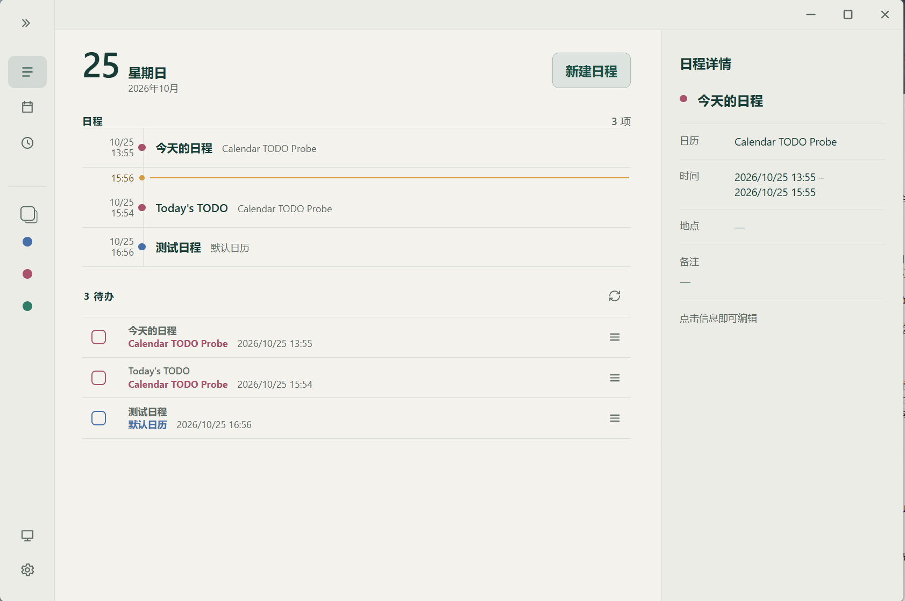

<p align="center">
  <a href="README.en.md">English</a> · <strong>简体中文</strong>
</p>

<p align="center">
  
</p>

<h1 align="center">Calendar TODO</h1>

<p align="center">把 iCloud 日历和待办清单都放到 Windows 桌面，专注眼前要做的事</p>

<p align="center">
  <a href="https://github.com/ke4989/CalendarTODO/releases">下载与发布记录</a> ·
  <a href="doc/INSTALL.md">安装指南</a> ·
  <a href="#从源码构建">从源码构建</a>
</p>

Calendar TODO 是一个面向 Windows 的日程与待办工具。既能接入 iCloud 日历查看和管理日程，也能使用本地保存；你可以在主窗口集中安排事项，也可以让桌面清单陪伴日常工作。

## 界面预览

### 主窗口

集中查看日程、管理日历，并在右侧编辑事项详情。



### 桌面清单

在更紧凑的窗口中查看和完成事项，支持桌面伴随与保持最前两种模式。

<p align="center">
  
</p>

## 核心功能

- **日历与待办**：按本地日历分类，设置时间、备注、标签、置顶和固定周期重复。
- **Windows 桌面清单**：独立的紧凑视图，支持折叠、背景不透明度调整和托盘快捷操作。
- **iCloud 日历**：选择需要显示与同步的日历；开启远程编辑后，可创建、修改和删除符合条件的日程。
- **顺手的日常操作**：拖动调整顺序、标记完成；日程事项编辑后自动保存。
- **通知与外观**：应用运行时提供 Windows 到期提醒，支持中英文界面、两套配色以及浅色、深色和跟随系统模式。

## 下载与安装

目标平台为 **Windows x64**，需要预先安装 **Microsoft Edge WebView2 Runtime**。暂不提供 macOS、Linux 或 ARM64 安装包。

可用安装包和对应版本说明以 [Releases 页面](https://github.com/ke4989/CalendarTODO/releases)实际提供的文件为准。

| 安装包 | 用途 |
|---|---|
| NSIS：`Calendar TODO_<版本>_x64-setup.exe` | 日常安装优先选择 |
| MSI：`Calendar TODO_<版本>_x64_en-US.msi` | 可选的 Windows Installer 安装包，以发布页为准 |

1. 下载一种安装包，并按同一版本的 `SHA256SUMS.txt` 核对 SHA-256。
2. 确认 WebView2 Runtime 已安装，再运行 Calendar TODO 安装包。
3. 启动应用，从本地日历创建第一条事项；无需云端账户。
4. 如果需要连接来自 iCloud 的日程并记入待办列表，请前往 [Apple ID](https://account.apple.com/) 官网获取 App 专用密码；密码会被保存于 Windows 凭据管理器，不会被应用泄露。

**安装包不会下载、捆绑或安装 WebView2 Runtime。** 不应假定每台 Windows 10／11 设备都已预装；若缺失，请通过[微软官方 WebView2 页面](https://developer.microsoft.com/en-us/microsoft-edge/webview2/)按指引自行安装，并查看微软提供的条款。缺少 Runtime 时，应用安装可能完成，但界面无法正常启动。

详细步骤、哈希核对、补装 Runtime 和卸载方法见[安装指南](doc/INSTALL.md)。具体 Windows 版本兼容性、签名状态与已知问题以对应发布说明为准；单独的应用 EXE 不作为便携版提供。

## 开始使用

- **先用本地日历**：创建事项并添加时间、备注或标签。主窗口详情会在短暂停顿后自动保存，桌面清单编辑使用显式保存。
- **按自己的方式查看**：通过托盘显示或隐藏桌面清单，在桌面伴随与保持最前之间切换。
- **完成与撤回**：标记已完成；误删后，在该条事项的五秒提示内选择“撤回”。
- **退出应用**：关闭主窗口会收起到托盘；在托盘菜单选择“退出”才会完全退出。依赖提醒时，请保持应用运行。

### 连接 iCloud 日历

在 **设置 → 日历与账户** 中添加 Apple 账户及 [App 专用密码](https://support.apple.com/102654)，选择需要显示与同步的日历。主要兼容目标是中国大陆区域 iCloud 账户；不承诺支持所有 CalDAV 服务。

远程编辑默认关闭。**开启后**，符合条件的新建、修改和删除会同步到 iCloud。遇到同步冲突或失败时，使用应用提供的冲突处理或重试操作。

**本地待办与 iCloud 日程是分开的数据来源。** 本地待办不会上传到 iCloud；日程的完成状态、标签、置顶等本地信息也不会写入远程日历字段。**不支持 Apple 提醒事项（Apple Reminders）。**

### 当前限制

- 暂不支持在应用内创建 iCloud 日历、编辑 iCloud 提醒时间或跨日历移动远程日程。
- 本地固定周期不等于编辑 iCloud 的重复规则；已有不支持的日历内容会保留并限制编辑。
- 本地待办和完成状态没有云端备份服务；崩溃或重启后的未保存草稿恢复可能无法正常保存。

## 隐私

本地待办、设置和日历缓存保存在应用管理的 SQLite 数据库中；保存的 App 专用密码由 Windows 凭据管理器处理。本地日历数据暂时未做静态加密。

连接 iCloud 时，应用会与 Apple 的 CalDAV 服务交换数据。

更多说明见[隐私说明（英文）](doc/PRIVACY.md)。

## 从源码构建

技术栈：TAURI® 2、Rust、Svelte 与 SQLite。

准备 Windows x64 开发环境：Node.js 22.12+ 与 npm、支持 Rust 2024 edition 的 MSVC 工具链、Visual Studio 2022 的 C++ 桌面开发工具及 Windows SDK，以及 CMake。运行应用还需要 WebView2 Runtime。

将源码放在较短的路径中，例如 `D:\src\CalendarTODO`，以避免原生依赖的 Windows 路径长度问题。在已加载 MSVC 和 Windows SDK 环境的 Visual Studio 开发者终端中，进入仓库根目录执行：

```powershell
npm ci --include=dev
npm run check
npm run tauri -- build --target x86_64-pc-windows-msvc --bundles nsis,msi
```

Tauri 会先构建前端，再构建应用和安装包。默认产物位于 `src-tauri/target/x86_64-pc-windows-msvc/release/bundle/`；配置了 `CARGO_TARGET_DIR` 时，以该目录为准。构建和打包可能下载公开依赖及安装器工具，不需要真实账户、凭据、用户数据库或私人配置。

开发模式使用 `npm run tauri -- dev`。

## 许可证与致谢

Calendar TODO 的原创贡献采用 [MIT License](LICENSE)，Copyright (c) 2026 ke4989。应用及安装器提供完整的离线许可文本；[Microsoft 组件附加条件](src/lib/legal/MICROSOFT_COMPONENT_TERMS.txt) 仅适用于其声明范围，不改变项目原创代码的 MIT 授权。安装时须明确同意适用条款，静默部署须按[安装指南](doc/INSTALL.md)传入同意参数。第三方代码、图标和安装器组件保留各自许可，详见[第三方声明](doc/THIRD_PARTY_NOTICES.md)及完整的 [THIRD_PARTY_NOTICES.txt](src/lib/legal/THIRD_PARTY_NOTICES.txt)。安装器再分发时还应遵守相关组件的条件和源码配套要求，详见[安装指南](doc/INSTALL.md)。

开发使用了 [Codex](https://openai.com/codex/) 、[Pi](https://pi.dev/) 及 [impeccable](https://github.com/pbakaus/impeccable) / [UI UX Pro Max](https://github.com/nextlevelbuilder/ui-ux-pro-max-skill) 进行 UI 设计，同时感谢 [magpie](https://github.com/yetone/magpie) 以及来自 [Workbuddy](https://www.workbuddy.cn/events/invite?inviteCode=732a87vsu6y) 的免费 Deepseek 额度。相关来源与许可边界见第三方声明。TAURI 是 The Tauri Programme within the Commons Conservancy 的商标；Apple、iCloud、Windows 与 Microsoft Edge WebView2 名称仅用于说明兼容性和平台依赖。Calendar TODO 是独立项目，未获这些组织背书。

## 文档

[简体中文](README.md) · [English](README.en.md) · [安装指南](doc/INSTALL.md) · [更新记录（英文）](doc/CHANGELOG.md) · [隐私说明（英文）](doc/PRIVACY.md) · [MIT License](LICENSE) · [第三方声明](doc/THIRD_PARTY_NOTICES.md)
